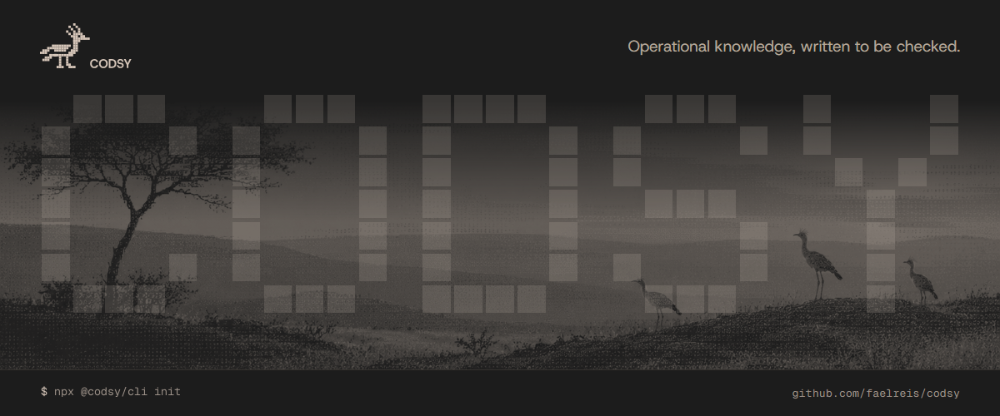

<p align="center">
  Write down how your company makes decisions, in simple files that people and AI agents can both read.
</p>

<p align="center">
  <a href="https://codsy.vercel.app/">Website</a> ·
  <a href="https://www.npmjs.com/package/@codsy/cli">npm</a> ·
  <a href="docs/getting-started.md">Getting started</a>
</p>

## What is Codsy, in one minute

Every company has rules that live in someone's head: "big customers go to a senior rep",
"refunds over $500 need a manager", "urgent tickets get answered in one hour".

Codsy helps you write those rules down as small text files, keep them in one folder,
and check them automatically. Think of it as a **spell checker for your company's
know-how**:

- You write a rule in plain English.
- Codsy tells you if something is missing, vague, or unsafe, and how to fix it.
- Codsy can test the rule with real examples to prove it gives the right answer.


## What a rule looks like

Each rule is a file called `SKILL.md`. This is a real one:

```markdown
---
name: lead-qualification
description: Decide whether a new lead goes to sales, used when a lead form arrives.
---

## Decision logic

Send a lead to sales when the company has 50 or more employees.

## Exceptions

Leads with no confirmed budget stay in nurture, no matter the size.
```

That's it: a name, a short description, the rule, and its exceptions. Anyone can read
it, and an AI agent can follow it.

## Pick your path

| You are...                           | Start here                                                     | Terminal needed? |
| ------------------------------------ | -------------------------------------------------------------- | ---------------- |
| A manager or CEO                     | [Use it in your browser](#path-1-use-it-in-your-browser)       | No               |
| Someone who owns a process           | [Try it in 5 minutes](#path-2-try-it-in-5-minutes)             | Yes, a little    |
| A developer setting it up for a team | [Add it to your repository](#path-3-add-it-to-your-repository) | Yes              |

## Path 1: Use it in your browser

No installation, no terminal.

1. Open the [starter template](https://github.com/faelreis/codsy-starter) on GitHub and
   click **Use this template** to make your own copy.
2. Open a file inside `skills/`, click the pencil icon, and write your rule.
3. Save it as a **pull request** (GitHub offers this when you save).
4. Wait a minute. Codsy leaves a comment on the pull request saying what, if anything,
   needs fixing, and exactly how.
5. Fix what it says, then merge. Your rule is now official and versioned.

## Path 2: Try it in 5 minutes

You only need [Node.js](https://nodejs.org) 22.12 or newer. Check with `node --version`.

### Step 1. Create a project

```bash
npx @codsy/cli init my-project --template sales
cd my-project
```

This creates a folder with a working example. Other templates: `blank`, `support`,
`finance`. Run `npx @codsy/cli init` with no options to be asked step by step instead.

### Step 2. Look around

Your new folder has four parts. Each one answers a simple question:

| Folder     | Question it answers         | Example                                           |
| ---------- | --------------------------- | ------------------------------------------------- |
| `skills/`  | What do we decide?          | "Who gets routed to sales?"                       |
| `schemas/` | What information do we use? | "A lead has a company size and a budget."         |
| `context/` | Why do we do it this way?   | "Our reps only have time for big accounts."       |
| `evals/`   | How do we know it works?    | "A 120-person company with budget goes to sales." |

Open `skills/lead-qualification/SKILL.md` to see a complete example.

### Step 3. Check it

```bash
npx @codsy/cli check
```

Codsy reads every file and reports problems such as a missing section, a vague rule, or a
password pasted by mistake. Each problem shows the file, the line, and the fix.

Don't understand a problem? Ask Codsy to explain it by its code:

```bash
npx @codsy/cli explain CODSY010
```

### Step 4. Add your own rule

```bash
npx @codsy/cli new skill
```

Codsy asks a few plain questions (what is decided, when, the rule, the exceptions, two
examples) and writes the file for you, showing a preview as you answer. It also creates
an empty test file in `evals/` for your examples.

### Step 5. Prove it gives the right answer (optional)

`codsy check` tells you the rule is **well written**. `codsy eval` tells you it is
**right**: it asks an AI model to apply your rule to each test case and compares the
answer with the one you expected.

This step calls an AI provider, so it needs an API key and may cost a few cents:

```bash
export ANTHROPIC_API_KEY=your-key-here
npx @codsy/cli eval
```

Want to see what would be sent, without calling anything or spending money?

```bash
npx @codsy/cli eval --dry-run
```

The provider and model are set in `codsy.config.yaml`. See
[Writing a good skill](docs/writing-a-good-skill.md) for the options.

### Your everyday routine

Once set up, working with Codsy is a short loop:

1. Edit or add a rule.
2. Run `codsy check` and fix what it reports.
3. Add a test case to `evals/` when you find a new real example.
4. Commit and open a pull request so someone reviews the change.

## Path 3: Add it to your repository

Every project created with `codsy init` already includes a GitHub workflow at
`.github/workflows/codsy.yml`. Push the folder to GitHub and every pull request is
checked automatically.

To add it to an existing repository, create that file yourself:

```yaml
name: Codsy

on:
  pull_request:

permissions:
  contents: read
  pull-requests: write
  security-events: write

jobs:
  check:
    runs-on: ubuntu-latest
    steps:
      - uses: actions/checkout@v7
      - uses: faelreis/codsy/action@v1
        with:
          strict: true
```

What happens on each pull request:

- Codsy checks every file and fails the build if there is an error.
- It posts one comment on the pull request with the full report, and updates it on
  each new push.
- If you add an `ANTHROPIC_API_KEY` or `OPENAI_API_KEY` secret to the repository, it
  also runs the eval tests. Without a key, only the free check runs.

More options: [GitHub Action](docs/github-action.md).

To install the CLI once instead of using `npx` every time:

```bash
npm install --global @codsy/cli
```

## All commands

| Command                | What it does                                        |
| ---------------------- | --------------------------------------------------- |
| `codsy`                | Shows the home screen                               |
| `codsy init [folder]`  | Creates a new project                               |
| `codsy new skill`      | Adds a new rule, with guided questions              |
| `codsy new schema`     | Adds a new data description, with guided questions  |
| `codsy check`          | Finds problems in your files                        |
| `codsy explain <CODE>` | Explains a problem code in plain words              |
| `codsy eval [skill]`   | Tests rules against their examples with an AI model |
| `codsy --help`         | Lists every command and option                      |

Every question Codsy asks can also be answered with an option, so all commands work in
scripts and CI. Add `--plain` for simple text output with no colors or animation.

## When not to use Codsy

- **One-time tasks.** Codsy is for decisions your company makes again and again.
- **Pure math.** Tax calculations or unit conversions should be code, not a written rule.
- **Facts that change every hour.** Prices and stock levels belong in a database, not
  in a file that goes through review.

## Learn more

- [Getting started](docs/getting-started.md): the full walkthrough and every option
- [Writing a good skill](docs/writing-a-good-skill.md): tips, test cases, AI providers
- [The methodology](docs/methodology.md): the thinking behind Codsy and how teams use it
- [Every rule Codsy checks](docs/rules/index.md)
- [FAQ](docs/faq.md)

Want to contribute? See [CONTRIBUTING.md](CONTRIBUTING.md). Rules live in `src/rules` as
pure `(project, config) => Diagnostic[]` functions.

## License

Apache-2.0. See [LICENSE](LICENSE).
